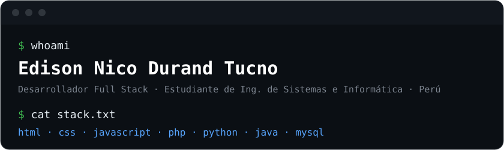

  

  
  

---

## $ whoami

Estudiante de Ingeniería de Sistemas e Informática y desarrollador Full Stack. Me interesan el desarrollo web, las bases de datos y la arquitectura de redes.

- Desarrollo ... (logros concretos, con números si puedes)
- ...

## Stack

**Frontend**

**Backend**

**Datos**

## Proyectos

<table>
  <tr>
    <td width="50%">
      <h3><a href="https://github.com/Nakusuo/SafeZone_Frontend">SafeZone</a></h3>
      
Plataforma de apoyo a víctimas de violencia con botón de pánico y alertas en tiempo real.

      <code>React</code> <code>TypeScript</code> <code>Tailwind</code>
    </td>
    <td width="50%">
      <h3><a href="https://github.com/EdisonNico/Rustica">Rústica</a></h3>
      
Descripción corta del proyecto.

      <code>TypeScript</code>
    </td>
  </tr>
</table>

## Actividad

